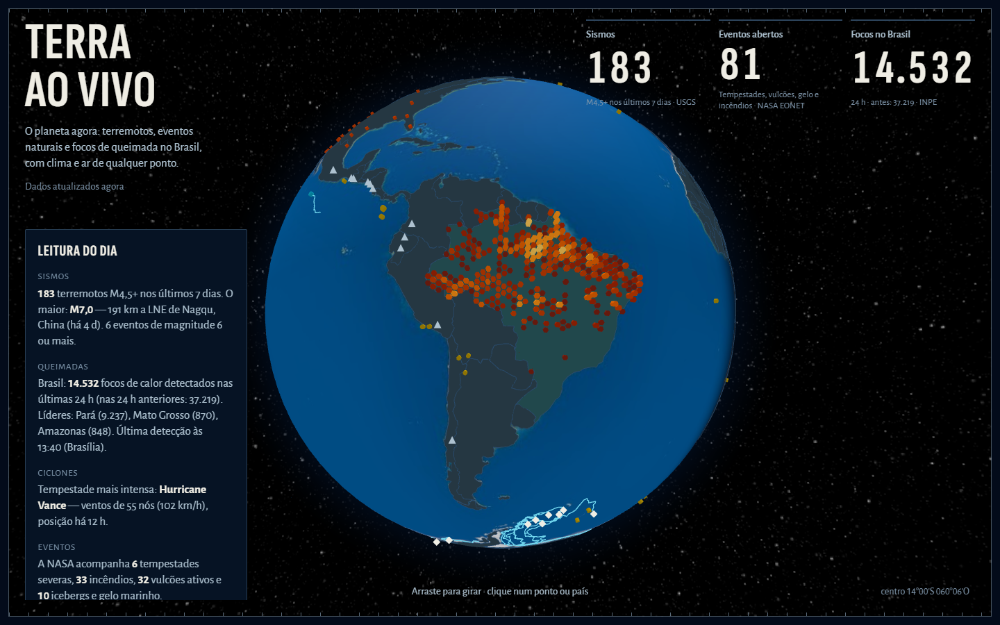
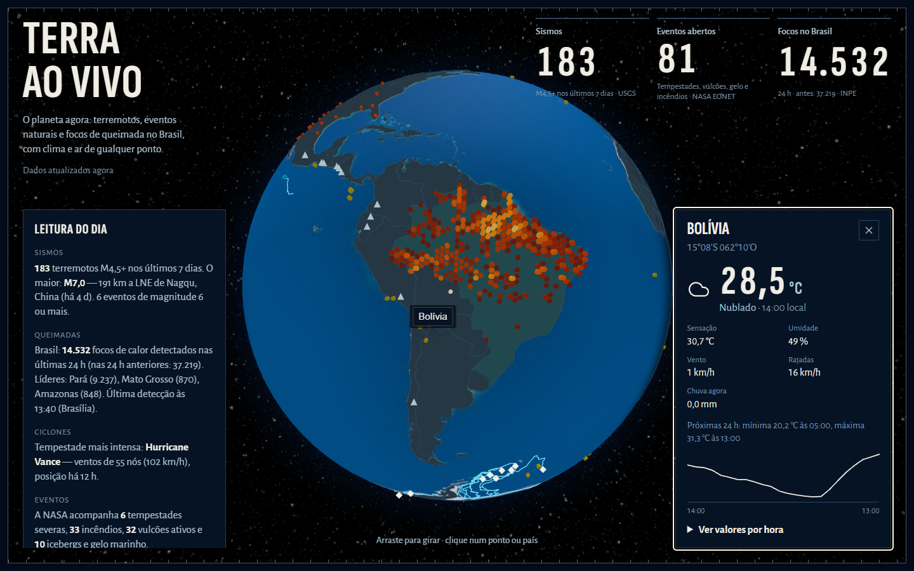
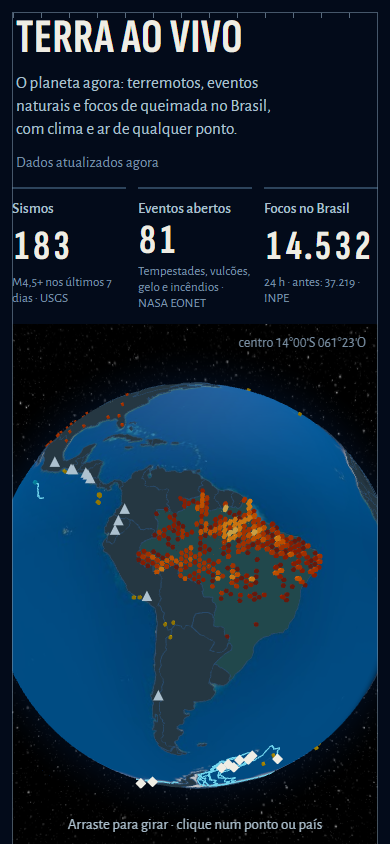
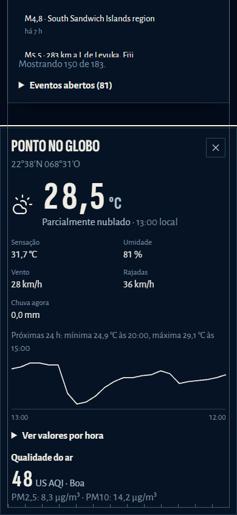

# Terra ao Vivo

**EN:** A 3D globe with live earthquakes, open natural events and Brazilian fire hotspots (INPE), updated while the tab is open.
Click any point to see current weather and air quality from Open-Meteo.
Static site, no backend, no API keys.

**PT:** Globo 3D com terremotos, eventos naturais e focos de queimada do Brasil, em tempo quase real.
Clique em qualquer ponto para ver clima e qualidade do ar. Site estático, sem backend e sem chave de API.





<p>
  
  
</p>

## Por que importa

Painéis de terremotos existem aos montes. Este junta feeds globais de eventos naturais com o dado brasileiro de
focos de calor do INPE e com consulta pontual de clima e ar, tudo no navegador. A ideia é mostrar, em uma tela,
que o dado é real, tem fonte e horário, e que cada falha é isolada: se uma fonte cair, as outras continuam.

## Arquitetura

```mermaid
flowchart LR
  subgraph Navegador
    UI[React + Vite] --> G[globe.gl / Three.js]
    UI --> Z[Zod: valida cada resposta]
  end
  USGS[(USGS sismos)] -->|GeoJSON, a cada 5 min| Z
  EONET[(NASA EONET)] -->|JSON| Z
  OM[(Open-Meteo clima e ar)] -->|sob clique| Z
  Z --> UI
  subgraph Build e ETL (GitHub Actions)
    INPE[(INPE CSV diário)] --> ETL[ETL Python: agrega em grade 0,1°]
    ETL -->|focos.json validado| PAGES[GitHub Pages]
  end
  PAGES --> UI
```

O CSV diário do INPE tem 4 a 5 MB. O ETL o transforma num JSON de ~30 KB e só publica se o dado passar nas
checagens (soma das células, janela de 24 h, última detecção recente).

## Fontes de dados

| Fonte | O que mostra | Chave | Limites e uso | Atribuição |
|---|---|---|---|---|
| [USGS Earthquake Hazards](https://earthquake.usgs.gov/earthquakes/feed/) | Sismos M2,5+ dos últimos 7 dias | Não | Feed público, atualizado pela USGS | "Dados: USGS" |
| [NASA EONET v3](https://eonet.gsfc.nasa.gov/docs/v3) | Tempestades, vulcões, gelo e incêndios abertos | Não | Consultas com `days=30` e `category=volcanoes` | "Dados: NASA EONET" |
| [INPE, Programa Queimadas](https://terrabrasilis.dpi.inpe.br/queimadas/portal/) | Focos de calor no Brasil, últimas 24 h (agregados) | Não | CSV diário, baixado pelo ETL com retry e backoff | "Dados: INPE" |
| [Open-Meteo](https://open-meteo.com/) (previsão e qualidade do ar) | Clima atual, 24 h e US AQI no ponto clicado | Não | Tier gratuito sem chave, para uso não comercial (confira os termos); consulta só sob clique | "Dados: Open-Meteo" |

Os nomes de país vêm de `world-atlas` (110 m) e `i18n-iso-countries`. As imagens de fundo vêm do repositório
`three-globe`; confirme a licença de cada uma antes de reusar (ver `docs/design.md`).

## Como rodar

Requisitos: Node 24 (`.nvmrc`) e, para o ETL, [uv](https://docs.astral.sh/uv/).

```bash
npm ci
npm run etl        # gera public/data/focos.json com os focos do INPE (precisa de rede)
npm run dev        # desenvolvimento
npm run build      # checagem de tipos + build de produção
npm run preview    # serve o build de produção
```

Scripts: `lint`, `typecheck`, `test` (Vitest), `etl:test` (pytest) e `etl:lint` (ruff).

Para publicar no GitHub Pages, o workflow `deploy.yml` roda o ETL, faz o build com
`VITE_BASE=/<repositorio>/` e publica. Ele também roda de hora em hora pelo cron.

## Segurança

- Sem chave, sem token e sem segredo no front-end.
- CSP por `<meta>` no build: scripts só de `'self'`; conexões só para os quatro hosts das APIs.
- `style-src` aceita estilo inline porque o globe.gl injeta CSS em tempo de execução. Detalhes em
  `docs/design.md`, seção 4.
- Sem `dangerouslySetInnerHTML`; links só `https:`.
- Workflows com `permissions` mínimas; Dependabot para npm, uv e Actions.

## Limitações conhecidas

- Os focos INPE são detecções de satélite. Podem incluir fogo industrial e não medem área queimada.
- A magnitude de sismos recentes é preliminar.
- O bundle do globo é grande (~546 KB gzip) e carrega depois da prancha.
- Testado em Chrome headless com WebGL por software. Não foi testado em navegadores com GPU real nem em Safari.
- Sem WebGL, o site mostra as mesmas leituras em lista, mas sem o globo.

Lista completa e decisões em [`docs/design.md`](docs/design.md).

## Roadmap

- Filtro por categoria de evento EONET.
- Histórico de focos do INPE por semana, com fonte no próprio ETL.
- Teste de navegador (Playwright) no CI para os caminhos de clique e de falha de fonte.

## Licença

MIT. Copyright (c) 2026 Herick Silva. Veja [`LICENSE`](LICENSE).
